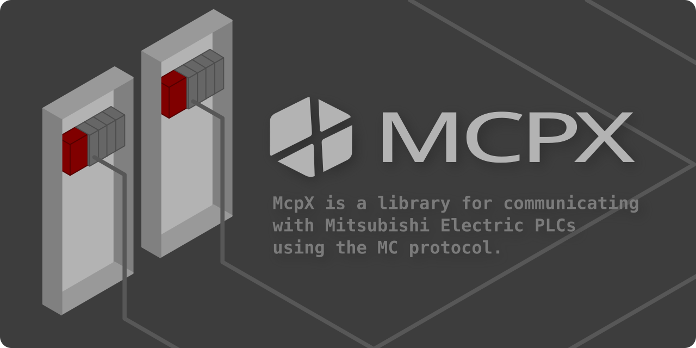
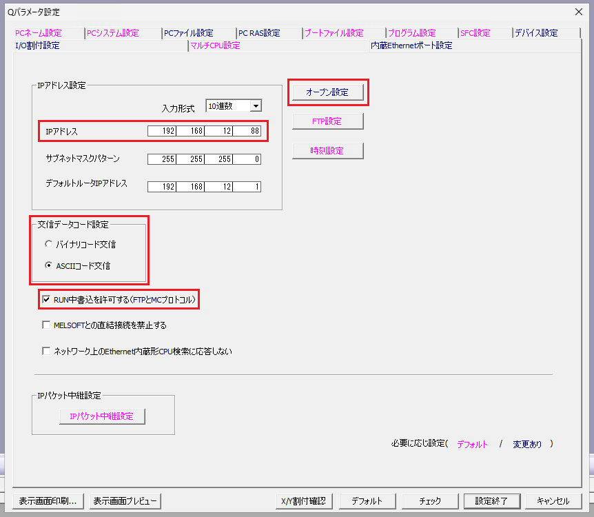
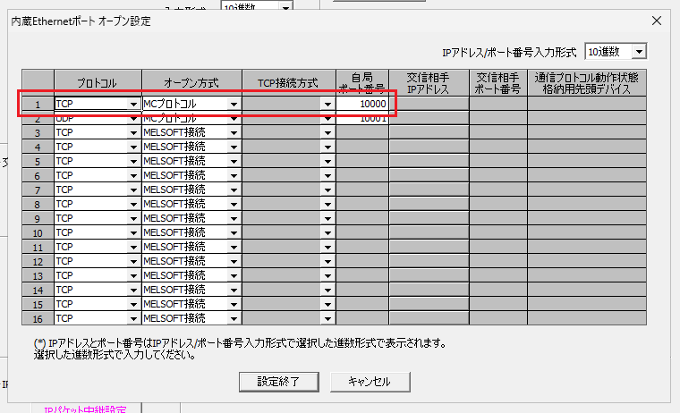

<br>
<p>
  
  
  
  
  
  
  
  
  
  <a href="https://flatt.tech/oss/gmo/trampoline" target="_blank"></a>
</p>

<p>
  <a href="README_JA.md">日本語</a> | <a href="README.md">English</a>
</p>

**Website & documentation: [mcpx.yktmr.jp](https://mcpx.yktmr.jp/en)** — overview, [API reference](https://mcpx.yktmr.jp/docs), and an [MC protocol guide](https://mcpx.yktmr.jp/en/learn).

**McpX is a library for communicating with Mitsubishi Electric PLCs using the MC protocol.**  
It features a simple and easy-to-use API, allowing you to communicate without worrying about MC protocol details.  
It runs on various platforms, including Linux, Windows, and macOS.

> Upgrading from 0.x? See the [migration guide](MIGRATION.md).

## Installation
### .NET CLI
```sh
dotnet add package McpX
```
### Package Manager(Visual Studio)
```sh
PM> NuGet\Install-Package McpX
```

## Example Usage
```csharp
using McpXLib;
using McpXLib.Enums;

// Connect to the PLC (TCP / binary code / 3E frame / MELSEC-Q/L series by default)
using var mcpx = McpX.Connect("192.168.12.88", 10000);

// Read 7000 points starting from M0 (requests over the limit are split automatically)
bool[] mArr = mcpx.BatchRead<bool>(Prefix.M, "0", 7000);

// Read 7000 words starting from D1000
short[] dArr = mcpx.BatchRead<short>(Prefix.D, "1000", 7000);

// Write 1234 to D0-D1 and 5678 to D2-D3 as signed 32-bit integers
mcpx.BatchWrite<int>(Prefix.D, "0", [1234, 5678]);

// Read a range and single devices together (ranges: batch access, single: random access)
short[] block = [];
int total = 0;
mcpx.Read(b => b
    .Add<short>(Prefix.D, "400", 100, v => block = v)
    .Add<int>(Prefix.D, "2000", v => total = v));
```
Every method has an async version that takes a `CancellationToken`:
```csharp
await using var mcpx = await McpX.ConnectAsync("192.168.12.88", 10000, cancellationToken);
short d0 = await mcpx.ReadAsync<short>(Prefix.D, "0", cancellationToken);
```
[C# and Visual Basic samples are available here.](https://github.com/YudaiKitamura/McpX/tree/main/Example)

### Connection Settings
Pass `McpXOptions` to `McpX.Connect` / `McpX.ConnectAsync` to match the PLC parameters.
```csharp
using var mcpx = await McpX.ConnectAsync(new McpXOptions
{
    Host = "192.168.12.89",
    Port = 5007,
    ProcessorSeries = ProcessorSeries.iQR,  // MELSEC iQ-R series (extended device specification)
    RequestFrame = RequestFrame.E4,
    IsAscii = false,
    IsUdp = false,
    Timeout = TimeSpan.FromSeconds(3),
    Password = "1234",                      // remote password (unlocked on connect, locked on dispose)
});
```

| Property | Description | Default |
|---|---|---|
| `Host` | IP address or host name of the PLC | (required) |
| `Port` | Port number (1–65535) | (required) |
| `Password` | Remote password. Unlocked on connect and locked on `Dispose` / `DisposeAsync` | `null` |
| `IsAscii` | `true` for ASCII code, `false` for binary code | `false` |
| `IsUdp` | `true` for UDP, `false` for TCP | `false` |
| `RequestFrame` | `RequestFrame.E3` (3E frame) / `RequestFrame.E4` (4E frame) | `E3` |
| `ProcessorSeries` | `ProcessorSeries.Q` (MELSEC-Q/L device specification) / `ProcessorSeries.iQR` (MELSEC iQ-R extended device specification) | `Q` |
| `Timeout` | Timeout for connecting and for each request. `Timeout.InfiniteTimeSpan` for no timeout | 5 s |
| `UseMultiBlockAccess` | Use multiple block access (commands 0406 / 1406) for the ranges of the combined `Read` / `Write` | `false` |
| `Route` | Access route to another station or CPU (see below) | own station |

### Accessing Other Stations
Specify `McpXRoute` (network No., PC No., request destination module I/O No. and station No.) to access another station on the network or another CPU of a multiple CPU system.
```csharp
// Station with network No. 1 / PC No. 2
var options = new McpXOptions { Host = "192.168.12.89", Port = 5007, Route = new McpXRoute(networkNo: 1, pcNo: 2) };

// CPU No. 2 of the multiple CPU system the connected module belongs to
options.Route = McpXRoute.ForCpu(2);
```

### Connecting to GX Simulator3
`McpXSimulator` connects to GX Simulator3 (the simulation function of GX Works3) by system No. and CPU No.
The port is `5500 + system No. × 10 + CPU No.` (e.g. system 1 / CPU 1 = 5511, system 2 / CPU 1 = 5521).
Connect once per simulator to connect to several simulators at the same time. The returned object is a regular `McpX`.
```csharp
using var sim1 = McpXSimulator.Connect();                                   // 127.0.0.1:5511 (system 1 / CPU 1)
using var sim2 = McpXSimulator.Connect(systemNo: 2, host: "192.168.12.90"); // 192.168.12.90:5521
using var cpu2 = await McpXSimulator.ConnectAsync(systemNo: 1, cpuNo: 2);   // 127.0.0.1:5512 (CPU No.2 of a multiple CPU system)

// To change other settings, start from CreateOptions
var options = McpXSimulator.CreateOptions(systemNo: 1, cpuNo: 1);
options.Timeout = TimeSpan.FromSeconds(10);
using var sim3 = McpX.Connect(options);
```
GX Simulator3 listens on 127.0.0.1 only. To connect from another PC, forward each port to 127.0.0.1 on the simulator PC (e.g. `netsh interface portproxy`).
Communication is TCP / binary code only (GX Simulator3 does not respond to ASCII code).

## Supported Commands

Every async method also takes an optional `CancellationToken`.

| Name                         | Description                                                            | Synchronous Method                                      | Asynchronous Method                                              |
|------------------------------|------------------------------------------------------------------------|---------------------------------------------------------|------------------------------------------------------------------|
| **Single Read**              | Reads a single value from the specified device.                        | `Read<T>(Prefix prefix, string address)`                | `ReadAsync<T>(Prefix prefix, string address)`                   |
| **Single Write**             | Writes a single value to the specified device.                         | `Write<T>(Prefix prefix, string address, T value)`     | `WriteAsync<T>(Prefix prefix, string address, T value)`         |
| **Batch Read**               | Reads multiple consecutive values starting from the specified address. | `BatchRead<T>(Prefix prefix, string address, int length)` | `BatchReadAsync<T>(Prefix prefix, string address, int length)` |
| **Batch Write**              | Writes an array of values to consecutive device addresses.             | `BatchWrite<T>(Prefix prefix, string address, T[] values)`   | `BatchWriteAsync<T>(Prefix prefix, string address, T[] values)` |
| **Random Read**              | Reads values from non-consecutive devices (bit / word / double-word). | `RandomRead(Action<RandomReadBuilder> build)`          | `RandomReadAsync(Action<RandomReadBuilder> build)`              |
| **Random Write**             | Writes values to non-consecutive devices (bit / word / double-word).  | `RandomWrite(Action<RandomWriteBuilder> build)`        | `RandomWriteAsync(Action<RandomWriteBuilder> build)`            |
| **Monitor Registration**     | Registers devices to monitor and returns a `MonitorSession`.           | `MonitorRegister(Action<MonitorBuilder> build)`          | `MonitorRegisterAsync(Action<MonitorBuilder> build)`             |
| **Monitor Read**             | Reads the latest values of registered devices via the returned session. | `MonitorSession.Read()`                              | `MonitorSession.ReadAsync()`                                   |
| **Combined Read**            | Reads consecutive ranges (with a point count) and single devices together; ranges use batch access (multiple block read for several ranges when `UseMultiBlockAccess` is enabled), single devices use random access. | `Read(Action<ReadBuilder> build)`   | `ReadAsync(Action<ReadBuilder> build)`   |
| **Combined Write**           | Writes consecutive ranges (arrays) and single devices together; arrays use batch access (multiple block write for several ranges when `UseMultiBlockAccess` is enabled), single values use random access. | `Write(Action<WriteBuilder> build)` | `WriteAsync(Action<WriteBuilder> build)` |
| **Multiple Block Read**      | Reads multiple ranges (blocks) of consecutive devices in one request (command 0406). | `BlockRead(Action<BlockReadBuilder> build)`   | `BlockReadAsync(Action<BlockReadBuilder> build)`   |
| **Multiple Block Write**     | Writes multiple ranges (blocks) of consecutive devices in one request (command 1406). | `BlockWrite(Action<BlockWriteBuilder> build)` | `BlockWriteAsync(Action<BlockWriteBuilder> build)` |
| **String Read / Write**      | Reads / writes a Shift_JIS string. The read length is in words.        | `ReadString(Prefix prefix, string address, int wordLength)` / `WriteString(Prefix prefix, string address, string value)` | `ReadStringAsync(...)` / `WriteStringAsync(...)` |
| **Remote RUN / STOP / PAUSE** | Changes the operating status of the CPU (commands 1001 / 1002 / 1003). | `RemoteRun(bool force, RemoteRunClearMode clearMode)` / `RemoteStop()` / `RemotePause(bool force)` | `RemoteRunAsync(...)` / `RemoteStopAsync()` / `RemotePauseAsync(...)` |
| **Remote Latch Clear / RESET** | Executes latch clear or reset (commands 1005 / 1006). Execute while the CPU is stopped. `RemoteReset` reconnects after the reset. | `RemoteLatchClear()` / `RemoteReset(TimeSpan? reconnectTimeout)` | `RemoteLatchClearAsync()` / `RemoteResetAsync(...)` |
| **Remote Password Unlock / Lock** | Unlocks the PLC with `McpXOptions.Password` when connecting and locks it when disposed (commands 1630 / 1631). | `McpX.Connect(options)` / `Dispose()` | `McpX.ConnectAsync(options)` / `DisposeAsync()` |

`T` can be `bool`, `short`, `ushort`, `int`, `uint`, `float`, `long`, `ulong`, `double`, `byte` and `sbyte` (`byte` / `sbyte` use one word each). Random access and monitoring support `bool`, `short`, `ushort`, `int`, `uint` and `float`.

## Errors and Thread Safety
- A PLC error code throws `McProtocolException` (`ErrorCode` has the end code), an invalid address throws `DeviceAddressException`, and a malformed response throws `ReceivePacketException`. They derive from `McpXException`.
- A timeout throws `TimeoutException`. After a timeout, communication error or cancellation over TCP, the connection is closed and later calls throw `IOException`; connect again.
- Calling a method after `Dispose` throws `ObjectDisposedException`.
- A `McpX` instance can be called from several threads and tasks at the same time; requests are sent one at a time. An operation split into several requests (such as a large batch read) may be interleaved with other requests.

## Supported PLCs and Protocols
| Item | Supported |
|---|---|
| PLC series | MELSEC iQ-R series (`ProcessorSeries.iQR`), MELSEC-Q/L series (`ProcessorSeries.Q`). Other models that support the 3E / 4E frame may also work but are not tested. |
| Transport | TCP, UDP |
| Frame | 3E frame, 4E frame |
| Code | Binary code, ASCII code |
| Simulator | GX Simulator3 |

## PLC Parameter Settings
When using the built-in Ethernet port, set the parameters in GX Works3 as follows.




| Setting | Description | McpX connection setting (`McpXOptions`) |
|:-|:-|:-|
| IP Address | The IP address of the PLC. | Set `Host` to the IP address of the PLC. |
| Communication Data Code | `Binary` or `ASCII`. | For `ASCII`, set `IsAscii` to `true`. |
| Enable online change (write during RUN) | Enable it to write to devices. | - |
| Protocol | `TCP` or `UDP`. | For `UDP`, set `IsUdp` to `true`. |
| Open System | `MC Protocol`. | - |
| Host Station Port No. | The port number to communicate on (1025 to 4999 or 5010 to 65534). | Set `Port` to the port number of the PLC. |

## Versioning
McpX follows [Semantic Versioning](https://semver.org/) from 1.0.0. Breaking changes to the public API are made only in a major version.

## Native Library (C ABI)
A native library (`mcpx.dll` / `mcpx.so` / `mcpx.dylib`) that exposes McpX as C functions. It does not require the .NET runtime and can be used from any language with an FFI, such as Python (ctypes) and Node.js (koffi). The native libraries are attached to each [release](https://github.com/YudaiKitamura/McpX/releases).
The header is [McpXInterop/include/mcpx.h](McpXInterop/include/mcpx.h). It supports single, batch, random and multiple block access, strings, monitoring and remote operations, and is built for Windows x64 / Linux x64 and arm64 / macOS arm64. Every function returns a status code (`MCPX_OK = 0`) and writes the details (including the PLC end code) to `mcpx_error` on failure.

```c
#include "mcpx.h"

mcpx_connect_options options;
mcpx_connect_options_init(&options);
options.host = "192.168.12.88";
options.port = 10000;

mcpx_error err = { .struct_size = sizeof(mcpx_error) };
mcpx_client_t plc;
if (mcpx_connect(&options, &plc, &err) == MCPX_OK)
{
    int16_t values[10];
    if (mcpx_batch_read(plc, MCPX_PREFIX_D, "0", MCPX_TYPE_I16, 10, values, sizeof(values), &err) != MCPX_OK)
    {
        printf("%s\n", err.message);
    }
    mcpx_close(plc, &err);
}
```

## Roadmap
- [x] ~~3E frame (ASCII code) support~~
- [x] ~~4E frame (binary code) support~~
- [x] ~~4E frame (ASCII code) support~~
- [x] ~~UDP support~~
- [x] ~~GX Simulator support~~
- [x] ~~Access to other stations~~
- [ ] Python / Node.js wrappers - In preparation

## Changelog
- [CHANGELOG.md](./CHANGELOG.md)

## Related
- [mcpx-mcp-server](https://github.com/YudaiKitamura/mcpx-mcp-server) An MCP(Model Context Protocol) server that enables real-time access to Mitsubishi Electric PLC devices from generative AI.
